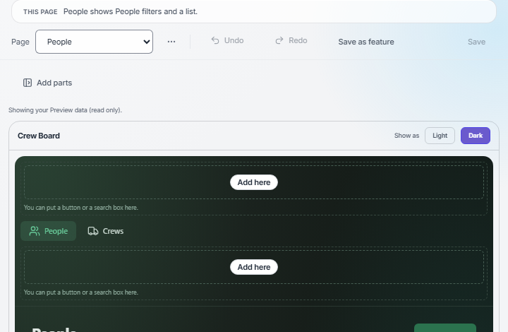
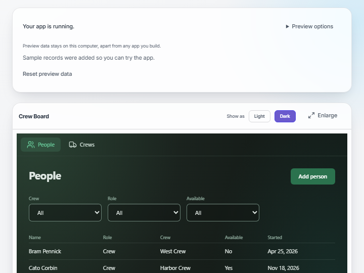

# Local App Studio

Local App Studio is a Windows desktop app for making small desktop apps from a set of ready-made parts. You design pages, tables and menus in Studio, try the app in Preview, and keep the data in one SQLite file on your own computer. It is local-first: no accounts, no telemetry, and nothing leaves your PC unless you turn on a named network feature in Settings.

Under the hood it is a Tauri v2 shell around a Node (Express) server and a React and Vite UI. The optional built-in assistant runs on a local [Ollama](https://ollama.com/download), never on a hosted model by default.

Only Windows is tested. macOS and Linux are untested, so this project makes no claim about them.

## Screenshots





## Requirements

- Windows.
- Node 24 or newer (`engines` in `package.json`; the server uses the built-in `node:sqlite`).
- Optional: [Ollama](https://ollama.com/download), only for the Assistant. Studio and Preview work without it.
- Only for the desktop shell: Rust (stable, https://rustup.rs), the Microsoft C++ Build Tools with the "Desktop development with C++" workload, and Microsoft Edge WebView2. See https://v2.tauri.app/start/prerequisites/.

## Install and run from source

Run these in PowerShell, in the repository folder:

```powershell
npm ci
npm run build
npm start
```

Then open http://127.0.0.1:4321 (set `APP_PORT` to use another port). This serves the built UI and the API from one process and uses your real per-user data folder. For a throwaway server with demo data on a free port, run `npm run sandbox` instead. For UI work, run `npm start` and `npm run dev` in two terminals and open http://localhost:5174.

To run the desktop shell against a temporary data folder (the first run compiles the Rust shell, a few minutes; it opens the app window and keeps running until you close it):

```powershell
npm run desktop:dev
```

## What a public checkout can build

- The web UI and server: `npm run build`, then `npm start`.
- The server sidecar bundle: `npm run desktop:sidecar` (needs `dist/` from `npm run build` first; a "The signature seems corrupted!" warning from the Node packaging step is expected for an unsigned bundle).
- The desktop shell in development: `npm run desktop:dev`.
- Not an installer. `npm run desktop:build` goes through `scripts/lib/proRun.js` to `scripts/desktop/build.js`, which in a public checkout is a stub: it prints "Making an installer is not in this build." and exits with code 1. Making installers, for Studio itself or for apps you design, needs the pro module (see below).

## What the public build does not include

The code is split into an open half and a pro half (`docs/ARCHITECTURE.md`, "The pro seam"). The pro half is not in this repository. Each pro module that open code imports has a public stub at its original path (the list is `PRO_SEAMS` in `scripts/lib/proDir.js`), and `src/proParts.js` sets every part to off. This is what you see instead:

| Not included | What you see in a public build |
| --- | --- |
| The helper pipeline (the Prompt step: describe an app in words, Ask for changes) | The Prompt step reads "Build your app in Design." and the Apps page offers "Start a blank app instead". The server answers `403 feature_unavailable`: "The helper is not in this build. Build it yourself in Design." |
| Make installer (the Build step, the build service, `npm run desktop:build`, the runtime template packaging) | The Build step reads "Share your app as a file." and build routes answer `403 feature_unavailable`: "Making an installer is not in this build. Export the app instead." |
| Licensing for built apps (store license keys, the 14-day trial, the Pro gate) | Licensing is off. The license status says "Licensing is not set up in this copy of Local App Studio, so every feature, Pro included, is available." There is nothing to activate and no trial starts. |
| The cloud provider (bring-your-own-key) | There is no cloud section in Settings. The `cloudAi` network feature answers `403 feature_unavailable`: "This build contains no cloud provider." The Assistant stays on local Ollama. |

The release scripts, the real-model eval (`npm run eval:ai`) and `npm run check:store-config` are pro too; in a public checkout they print that the tool is not in this build.

Export, import, backups and privacy controls are never gated, in any build.

## License

The core is licensed under the GNU Affero General Public License v3.0 (`LICENSE`). The package in `packages/runtime/` is MIT (`packages/runtime/LICENSE`); it is the slice that ships inside apps built with Studio. The pro half is source-available under FSL-1.1-MIT and is not part of this repository. One caveat, stated plainly: the runtime package still imports AGPL code from the core (the catalog core, shared components, contexts, utils and `server/db`), so it is not self-contained, and which license a built app carries as a whole is not settled. Check this before you ship an app you plan to sell. Third-party notices are in `THIRD_PARTY_NOTICES.md`.

## More

- [docs/USER_GUIDE.md](docs/USER_GUIDE.md): the five steps, from an idea to an app.
- [docs/ARCHITECTURE.md](docs/ARCHITECTURE.md): process model, security, data folder, the pro seam.
- [CONTRIBUTING.md](CONTRIBUTING.md): setup, checks, commit rules.
- [SECURITY.md](SECURITY.md): how to report a vulnerability.
- [CHANGELOG.md](CHANGELOG.md) and [CODE_OF_CONDUCT.md](CODE_OF_CONDUCT.md).
