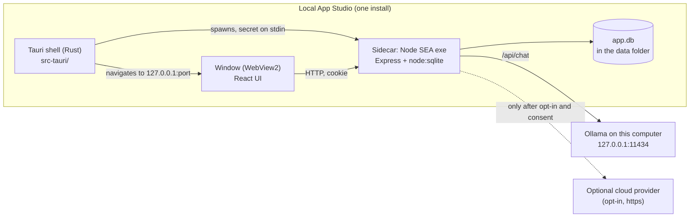

# Architecture

How Local App Studio is put together, and what its security design does and does not cover. Everything here is read from the code. The Rust shell protocol in more detail is in [src-tauri/README.md](../src-tauri/README.md).

## Process model

Local App Studio is two processes plus a local model server you may or may not run.



- **The shell** (`src-tauri/`) has no product code. It starts the server, shows a local splash page while the server boots, then points the window at `http://127.0.0.1:<port>`. The window gets no Tauri IPC: `src-tauri/capabilities/default.json` grants no permissions and has no `remote` entry.
- **The sidecar** is the whole backend: `server.js` (Express 5), the `server/` folder and the built UI from `dist/`. `npm run desktop:sidecar` bundles it with esbuild into one CommonJS file and injects it into a copy of `node.exe` as a Node single executable application (SEA). The result is copied to `src-tauri/binaries/`, with `dist/` and the SQL migrations as plain resource files beside it. The sidecar embeds the Node you build with, so each target (x64, ARM64) must be built on that architecture. The bundle entry is `server/entry.js`, which also starts the same exe as the document parser child (`--role parser`, see [INGEST.md](INGEST.md)).
- **Ollama** is a separate program the user installs. The sidecar talks to it over loopback only (see [AI.md](AI.md)).

In development, `npm run desktop:dev` runs the same shell against `node server.js` instead of the sidecar exe, with a temporary data folder.

### Startup sequence

1. The shell starts the sidecar with an almost empty environment: only `SystemRoot`, `TEMP`, `TMP`, `APPDATA`, `LOCALAPPDATA`, `USERPROFILE`, `HOME`, `XDG_DATA_HOME` (each if set), a fixed `PATH`, and `APP_DESKTOP=1`, `APP_HOST=127.0.0.1`, `APP_PORT=0`, `APP_NO_DOTENV=1`, `APP_SHELL_CHANNEL`, `APP_DIST_DIR`, `APP_MIGRATIONS_DIR`, plus `APP_DATA_DIR` only when you set `APP_DESKTOP_DATA_DIR`. Variables such as `NODE_OPTIONS`, `OLLAMA_HOST` and tokens from the user's shell are dropped.
2. The shell writes a random 32-byte secret (as 64 hex characters and a newline) to the sidecar's stdin and keeps stdin open.
3. The sidecar reads the secret, runs recovery for any interrupted backup restore, opens and migrates the database, and listens on a free loopback port (`APP_PORT=0`).
4. It prints one line, `APP_READY {"port":N,"dataDir":"...","version":"...","channel":"stable|dev"}`. The shell waits up to 60 seconds for it, then opens `http://127.0.0.1:N/desktop/bootstrap?token=<token>`.
5. The server checks the token, sets a cookie and redirects to `/`. From then on every request must carry the cookie.

If the server exits or the wait times out, the window shows an error page with the log path, and a native dialog explains the exit code. Exit codes: `0` clean shutdown, `1` startup failure, `2` invalid desktop handshake, `3` startup recovery of an interrupted restore failed, `5` the server stopped itself after an unexpected error left it in an unsafe state (see "Logs and process guards").

### Shutdown

Closing stdin is the shutdown signal. The server stops its schedulers, closes connections, lets a running backup finish (up to 1.5 seconds) and checkpoints the database. The shell waits 5 seconds, then kills the process. On Windows the sidecar is also placed in a Job Object with kill-on-close, so if the app crashes or is killed, Windows ends the sidecar too and no server is left running.

### Logs and process guards

`server/log.js` gives every request an id (the `X-Request-Id` header, in and out) and writes one redacted JSON line per request and per error: into a ring of the last 500 records in memory and into `<data folder>/logs/server.jsonl`, which rolls at 2 MB with three older files kept. Request bodies, query strings, headers, prompts and record values are never logged. Every error the server sends goes through `server/errors.js` as one envelope, `{ error, code, action, requestId }`, so a person's screen, the log line and a report all share the id. The Describe and Build pipelines and migrations log their stage timings under the same id, and `APP_DEBUG=1` (or the session switch on Settings > Diagnostics) adds slow query lines and more detail. Details and how to read a report are in [DEBUGGING.md](DEBUGGING.md).

`server/processGuards.js` handles `uncaughtException` and `unhandledRejection` in the Studio server and in a built app's server. A rejection never ends the process, and an uncaught exception only does when the state is unsafe (an open transaction, a damaged database, stack overflow, out of memory, or a second one within a minute): then the server finishes the open responses with `server_error`, stops normally and exits `5`. Anything else answers the request in context with `server_error` and keeps running. The Tauri shell does not restart the sidecar; after an exit it shows its error page and dialog.

## Security layers

Each layer below is enforced in code, and most have tests.

| Layer | Where | What it does |
| --- | --- | --- |
| Loopback bind | `server/config.js` | In desktop mode the server refuses to start on a non-loopback address |
| Host guard | `server/hostGuard.js` | First middleware. A request whose `Host` header is not a loopback name (or a name you listed in `APP_ALLOWED_HOSTS`) gets `421 { error: 'Host not allowed' }`. This blocks DNS-rebinding pages |
| Per-launch secret | `server/desktop/auth.js`, `src-tauri/src/secret.rs` | Generated fresh each launch, passed over stdin only (never argv, env, HTTP or logs). The bootstrap token and cookie are HMACs of it |
| Single-use bootstrap | `server/desktop/auth.js` | `GET /desktop/bootstrap?token=...` works once. A reused or wrong token gets `403` and a "lost its session" page |
| Cookie gate | `server/desktop/auth.js` | Every other request needs the `app_desktop` cookie (`HttpOnly`, `SameSite=Strict`). Without it: `401 { error: 'desktop_auth_required' }` for `/api/*`, a plain page elsewhere |
| Cross-site and origin checks | `server/desktop/auth.js`, `server.js` | `Sec-Fetch-Site: cross-site` gets `403 cross_site_blocked`. A write with a foreign `Origin` gets `403 origin_not_allowed`. In desktop mode the CORS allowlist is empty |
| CSP and headers | `server/desktop/csp.js` | On every response: `Content-Security-Policy`, `X-Frame-Options: DENY`, `Referrer-Policy: no-referrer`, `X-Content-Type-Options: nosniff` |
| No IPC | `src-tauri/capabilities/default.json` | The server UI cannot call Tauri commands |
| Navigation policy | `src-tauri/src/nav.rs` | Only the splash pages and `http://127.0.0.1:<port>` load in the window. Web links and `mailto:` open in the default app. Everything else is dropped. New windows never open |
| Downloads | `src-tauri/src/downloads.rs` | Only downloads that start from the app's own origin are allowed, saved to Downloads without overwriting |
| Single instance | `src-tauri/src/lib.rs` | A second launch focuses the existing window |
| Rate limits | `server.js` | A global cap on `/api` plus tighter caps on model calls, secret writes and license store calls |
| Database access | `server/db/query.js`, `server/db/tables.js` | All SQL goes through helpers with table and column names allowlisted. No SQL is built from request input |
| Secrets at rest | `server/secrets/` | Saved API keys are encrypted with AES-256-GCM. The key is `secrets.key` in the data folder (or `SECRETS_ENCRYPTION_KEY`) |

### The CSP

The desktop CSP is built at startup from the built `index.html`. The one inline script (the pre-paint theme setter) is allowed by its SHA-256 hash, so `script-src` never needs `'unsafe-inline'`:

```
default-src 'self'; script-src 'self' 'sha256-...'; style-src 'self'; style-src-attr 'unsafe-inline';
img-src 'self' data: blob:; font-src 'self' data:; connect-src 'self'; object-src 'none';
base-uri 'none'; form-action 'self'; frame-ancestors 'none'
```

`style-src-attr 'unsafe-inline'` exists because React and the chart library set inline `style=""` attributes at runtime. Attribute styles cannot run script. The splash pages inside the shell use their own CSP from `tauri.conf.json`: `default-src 'self'; style-src 'self'`.

The consequence for you: the UI can only call its own server (`connect-src 'self'`). If your module needs the internet, the call goes through the server and a `netPolicy` feature, never straight from the browser.

## Request flow

```
Window (WebView2)
   |  GET/POST /api/...   Cookie: app_desktop=...
   v
Express (server.js), in this order:
   1. host guard ............ wrong Host                -> 421
   2. security headers + desktop gate
                              no cookie                 -> 401
                              cross-site / bad Origin   -> 403
   3. CORS (empty list in desktop mode)
   4. JSON body parser (2 MB; /api/export has its own 10 KB limit, /api/ingest/parse its own ~34 MB limit set in its route; the /api/ingest prefix is Cache-Control: no-store)
   5. rate limits (global, model calls, secrets, license)
   6. auth gate (APP_PASSWORD) .... ignored in desktop mode
   7. secrets primer, restore gate (503 db_restoring during a restore)
   8. routes ................ data, assistant, settings, backups, export, import, license ...
   9. unmatched /api/*                                  -> 404, code not_found (the error envelope)
  10. static UI (dist/) and SPA fallback
   v
server/dataAccess.js  ->  server/db/query.js  ->  app.db (SQLite, WAL)
```

A route that needs the model adds `requireAi(...)` and calls it through `server/ai/index.js`. A route that needs the internet adds `requireNetwork('<feature>')` from `server/netPolicy.js`. A Pro route adds `requirePro('<id>')` first. See [ADDING_A_MODULE.md](ADDING_A_MODULE.md).

## Data folder

By default the data folder is `%APPDATA%\Local App Studio` (Windows). The sidecar creates it on first run. `server/paths.js` decides:

1. `APP_DATA_DIR`, if set, wins. The shell sets it for the sidecar only when the shell itself has `APP_DESKTOP_DATA_DIR`.
2. Otherwise the per-user folder for the platform and channel (the Dev build uses its own folder, see [DEV_CHANNEL.md](DEV_CHANNEL.md)).

**`APP_DESKTOP_DATA_DIR`** is the developer override read by the Rust shell. `npm run desktop:dev` sets it to a fresh folder under the OS temp folder so development never touches real data. Set it per shell only, never as a permanent user variable: installed builds honour it too, and log a line to `server.log` when it is active. On Windows, `secrets.key` is protected only by the folder's inherited ACL, so do not point the data folder at a shared folder.

What lives in the data folder:

| Item | What |
| --- | --- |
| `app.db` (plus `-wal` and `-shm` while running) | The database |
| `backups/` | Daily local backups and safety copies |
| `logs/` | `server.jsonl` and up to three rotated files: the redacted structured log (see [DEBUGGING.md](DEBUGGING.md)) |
| `secrets.key` | The key that encrypts saved API keys. Back it up with the data. It is kept out of exports |
| `license-activation.json`, `license-clock.json`, `license-trial.json` | Tamper-protected licensing records (only if licensing is on) |
| `restore-journal.json`, `restore-aside/` | Present only while a backup restore is in progress or was interrupted |

The shell's own log file, `server.log`, is in the app log folder, not the data folder: `%LOCALAPPDATA%\com.neuralfoundry.localappstudio\logs\server.log`. It holds the server's stdout and stderr and is replaced at each launch.

### Migrations

Migrations are forward-only SQL files in `server/db/migrations/` (`NNN_name.sql`). Before one runs, the database is copied to a `.pre-v<N>.bak` file, and a failing migration rolls back and leaves the live file untouched. A SHA-256 lock (`server/db/migrations.lock.json`) makes shipped migrations immutable, and `server/__tests__/migrationSafety.test.js` upgrades a populated database from every older version.

### Preview data

Studio's Preview runs each app in a child server with its own scratch folder, `<preview root>/<app id>/` (`previewRoot()` in `server/studio/preview/paths.js`: `APP_PREVIEW_DIR`, else `${APP_DATA_DIR}-preview`, else `%LOCALAPPDATA%\<data folder name>\preview` on Windows). It is separate from built apps and from Studio's own data folder. The Preview records are `data/app.db` in that folder. The folder also holds `app-spec.json`, `applied-spec.json` (the spec whose tables the chain builds), `preview-state.json` (`v: 2`, a hash of the tables and the chain's file list) and `app-migrations/NNN_app.sql` with its lock.

Rows are kept across a Stop and Start, a Studio restart and every table change a built app could take. `server/studio/preview/scratch.js` plans the change with `planMigration` (the same allowlisted SQL generator a built app update uses), appends the next `NNN_app.sql` and lets the child apply it with its usual backup. A change `planMigration` refuses (a removed table or field, a required field without a default, an unsupported type change) clears the data. If the child cannot apply a new migration, the manager clears the data and starts fresh once. The status carries `data: { kept, reason }` (`first_start`, `unchanged`, `tables_updated`, `tables_replaced`, `repaired`, `reset`) and the Preview tab says what happened.

Reset preview data (`POST /api/studio/preview/reset`, body `{ appId, confirm: "reset" }`) stops the app's child if it runs, deletes only `data`, `app-migrations`, `preview-state.json` and `applied-spec.json` in that app's scratch folder (`RESETTABLE`), and starts the child again on an empty database. The app id must be a UUID and the folder must resolve inside the preview root.

## The pro seam

The code is split into an open half and a source-available half. The pro half lives in `pro/` (the helper, the Make installer and release automation, licensing and the Pro gate, the cloud provider; see `pro/README.md` (pro, not in the public source) and [LICENSING.md](LICENSING.md), "What will be open and what stays pro"). Each pro module that open code imports is a **seam**: its real code (the pro twin) sits at the same relative path under `pro/`, and a public stub with the same export names sits at the original path. The seams are the frozen list `PRO_SEAMS` in `scripts/lib/proDir.js`. A pro module that only other pro modules import moves without a stub.

`resolveProDir()` in the same file is the one reader of `APP_PRO_DIR`. Unset or empty means `pro/` when `pro/server` is a folder, else the public build. `none` means the public build even when `pro/` is present. Any other value is a folder (absolute, or relative to the repo); a folder that is not there throws, so a typo never becomes a quiet public build. In a public build the stubs are the code: licensing is off, and a server route for a part that is not in the build answers `403 feature_unavailable`.

### Where it is resolved

| # | Where | How |
| --- | --- | --- |
| 1 | `vite.config.js` (`npm run build`, `npm run dev`) | `proSeamVitePlugin` (`scripts/lib/proSeam.js`) redirects a seam import to its twin, and in a public build refuses to load any file under `pro/`. `vitest.config.js` adds the same plugin to its three projects, so a test run follows the same build. |
| 2 | `scripts/desktop/buildSidecar.js` (and the backup worker bundle in `workerBundle.js`) | `proSeamEsbuildPlugin`: the same redirect and the same refusal for the sidecar bundle. It is registered after the cloud provider swap, so a cloud-off build still gets the `.disabled` provider. |
| 3 | The Tauri resources step: `pro/scripts/packageTemplate.mjs`, which writes `src-tauri/resources/runtime-template.zip` | Reads the pro files a built app needs from the resolved folder and writes them under `pro/` in the template (the licensing twins, the gate, the blanked store config, the cloud twins, `src/proParts.js`, `scripts/desktop/build.js`, `pro/LICENSE`). The helper, the installer pipeline, the eval set, the release scripts and every test under `pro/` stay out. A public build has no template to package (the stub at `scripts/packageTemplate.mjs` says so); `buildSidecar.js` still copies `dist/` and the migrations into `src-tauri/resources`. |

### Source checkouts

A bundle never loads `pro/` at run time: the choice is made when it is built. Code that runs unbundled needs the same decision, so it is made by a Node module hook:

- `scripts/lib/proHook.js` is an `--import` target. It calls `resolveProDir`, registers `scripts/lib/proResolveHook.js` (which redirects a seam URL to its twin) in a pro build, and writes the decision back to `process.env.APP_PRO_DIR` (`none` or the absolute folder) so a child process such as the Preview child agrees. `npm start` (`node --import ./scripts/lib/proHook.js server.js`), `e2e/support/appServer.js`, `scripts/sandbox.js` and the Preview manager's child spawn (`server/studio/preview/manager.js`, source checkouts only) use it.
- `devServer.js` is the entry `npm run desktop:dev` runs (`APP_DEV_ENTRY`): the shell starts `node <entry>` with no flags, so it imports the hook and then loads `server.js`.
- `scripts/lib/proRun.js <script>` runs a CLI that has a twin (`eval:ai`, `desktop:build`, `template:package`, `check:store-config`, the release scripts): in a pro build it runs the twin under `pro/` with the hook, in a public build it runs the stub, which says the tool is not in this build and exits 1. It accepts only a path in `PRO_SEAMS` (anything else is refused in one line), and a missing twin is one plain line and exit 1.
- Every other `node <file>` launch (`package.json` scripts, workflow steps) whose import graph reaches a seam goes through the hook (`npm run doctor` does); `server/__tests__/proEntryPoints.test.js` walks them and fails on one that does not. The build tools (`buildSidecar.js`, `buildDev.js`) pick the seam themselves and never read `PRO_PARTS`. The Preview child always starts with the hook (the SEA child never does). The backup worker thread imports no seam, so it needs no hook (the same test keeps that true).

### The build flag

`src/proParts.js` is a seam too: the stub exports `PRO_PARTS` with `helper`, `installer`, `licensing` and `cloud` all `false`, the twin all `true`. `server/buildFeatures.js` reads it: `isProPartInBuild(part)`, `requireInBuild(part)` (Express middleware that answers `403 feature_unavailable` with the part in `feature`; mounted first on the Describe route for `helper` and on every build route for `installer`, before body validation and `requireAi`) and `getCloudAiBuild`, which answers `off` when `PRO_PARTS.cloud` is false. The Studio reads the same flag to show a plain surface in place of the helper or the installer (docs/DESIGN.md, "Studio copy").

### The two checks

Every pro twin that is a seam ends with `export const PRO_MARKER = 'las-pro-marker:<seam path>:v1'` and a push of that string to `globalThis.__LAS_PRO__`, so a bundler keeps it even when nothing imports the constant. A stub has no marker. `scripts/checks/proMarker.js` (`npm run check:pro-marker`) looks for the markers, and for fragments that only pro files contain (`PRO_ONLY_STRINGS`), in a build artifact.

- `npm run check` runs `check:pro-marker -- --require-present --source`: every seam has a stub and a twin, every twin has its marker, no stub has one, no tracked file outside `pro/` holds a pro-only string, and no tracked code file outside `pro/` imports a path under `pro/` (only a test may, because it skips itself in a public build). Every non-test code file under `pro/` has a marker or contributes at least one `PRO_ONLY_STRINGS` fragment (`proMarker.test.js`). It scans no build output.
- `npm run check:public` (`scripts/checks/publicBuild.js`) builds the public half with `APP_PRO_DIR=none`, even when `pro/` is present: `vite build`, then the studio and the runtime sidecar bundles (`--bundle-only`), then `check:pro-marker -- --require-absent` and `check:cloud-marker -- --require-absent` on `dist/` and both bundles. It leaves a public build in `dist/`; run `npm run build` again for a pro build. `check:pro-marker -- --require-present` on a pro build's outputs is the other half. The gate and the `verify` job run it last (step `public build`, after e2e, which needs the pro build in `dist/`), and each `main-unit` shard also runs the whole suite with `APP_PRO_DIR=none`.

Tailwind reads `pro/src/` through an explicit `@source` in `src/index.css` (automatic detection is off, so `pro/` is scanned only by that line): the cloud screens use classes no open file uses. A public build keeps those two utility rules and none of the code.

Tests: `server/__tests__/proSeam.test.js` (the resolver, the plugins and the hook), `proEntryPoints.test.js` (every launch reaches the hook), `proSeamExports.test.js` (every stub and twin export the same names apart from `PRO_MARKER`; skipped with a reason when `pro/` is absent) and `proMarker.test.js`. End-to-end specs that need the helper or the installer carry the tag `@pro` and skip with a reason in a public build (`e2e/support/proBuild.js`); `e2e/flows/publicBuild.spec.js` covers the public build.

## The runtime package

`packages/runtime/` is an npm workspace package, `@local-app-studio/runtime` (`private`, license MIT, `packages/runtime/LICENSE`, no dependencies of its own). It holds the slice that ships inside every built app: the app spec (`src/spec`), the theme engine (`src/theme`), the part catalog components (`src/catalog/parts`), the renderer (`src/runtime`) and the runtime server routes (`server`). Code outside the package imports it by name: `@local-app-studio/runtime/<path under src/>` or `@local-app-studio/runtime/server/<file>`. Vite and Vitest resolve that through the aliases in `scripts/lib/runtimeAlias.js`, the type checker through `tsconfig.json` `paths`, and esbuild and Node through the workspace link and the package's `exports` map. The slice still imports parts of the open core (the catalog core under `src/catalog`, `src/components/shared`, `src/contexts`, `src/utils`, `server/db`), so it is not self-contained. The runtime template ships the whole package with its `LICENSE` and a `THIRD_PARTY_NOTICES.md` entry, and `pro/server/__tests__/templateParity.test.js` proves the template still matches the one made before the move.

## Studio feature map by phase

Where each Studio feature lives in the tree, in phase order. Moved here from `CLAUDE.md`, whose architecture map keeps one line pointing at this section. Each bullet is text as it stood in `CLAUDE.md`; the phase design notes under `docs/phaseNN/` hold the reasoning.

- Layer sizing (phase 9, ADR-009): `packages/runtime/src/spec/sizing.ts` is the pure optional `sizing` block (width and grow) with its tolerant reader; `packages/runtime/src/catalog/parts/sizingClasses.ts` the literal Tailwind class tables and the row grouping shared by the renderer and the canvas; `src/studio/lib/sizingWords.ts` the plain words for widths. On the design canvas, `ResizeHandle.tsx` drags the edge between two parts in a row and `WidthSettings.tsx` is the Width section of the settings popover.
- Menu slots (phase 10, ADR-010): `packages/runtime/src/spec/menuSlots.ts` is the pure optional `menu.start` and `menu.end` slots (parts in the menu bar) with their walk; `packages/runtime/src/catalog/parts/menuSearch.ts` what a menu SearchBox searches (the open page's first list) and `menuClasses.ts` the literal class tables; `packages/runtime/src/runtime/menuSlots.jsx` renders the slots and portals page parts into them. In Design, `src/studio/design/MenuCanvas.tsx` edits the menu bar on the canvas with the pure tree helpers in `src/studio/lib/menuTree.ts`; `ActionSettings.tsx` is the "What it does" choice of Button, with `src/studio/lib/actionKind.ts`.
- Data connections (phase 10): `src/studio/lib/bindChoice.ts` picks the table or source for a part and `bindOnDrop.ts` plans a drop (bind, add a page source, choose or refuse); `src/studio/design/connections.ts` finds parts that need a table or add to a table the page does not show, `keptConnections.ts` stores "Keep it this way" per app in browser storage, and `ConnectionBadge.tsx`, `NotConnected.tsx` and `ConnectionIssues.tsx` show them. `src/studio/showcase/usesData.ts` marks Features tiles that use data (Sample data); `src/studio/components/PreviewDataBanner.tsx` says what happened to Preview data. `server/db/errors.js` maps the preview child's migration failure to exit 4, and `POST /api/studio/preview/reset` (`server/studio/previewRoutes.js`) clears the Preview data of one app.
- Prompt with the review beside it, the indicator and the Feature builder (phase 16): the Prompt step is two panes (`src/studio/pages/DescribeTab.tsx` for the prompt, `components/ReviewPane.tsx` for the check, `AskForChange.tsx`, `PromptBullets.tsx`); there is no Review step (five steps in `src/studio/lib/steps.ts`, `/review` redirects to `/prompt`). `src/studio/lib/promptBullets.ts` is the pure grammar of the review bullets (and `pageBullet` for the page strip). `src/studio/design/indicator.ts` is the one pure function behind the pill on every data part and feature block (`partIndicator`: Connected to, Needs a table, Needs a field, Uses slot; also `specNeeds`, `entryNeedsTable`) and `ConnectionBadge.tsx` the one component that draws it. `src/studio/design/PageStrip.tsx` is the row above the Design toolbar (page bullet, `Ask the helper to change this page`). `src/studio/builder/` is the Feature builder (`bench.ts` the in-memory bench app and sample tables, `slotModel.ts` slots to feature parameters, `SlotPanel.tsx`, `SlotTableDialog.tsx`, `BuilderSaveDialog.tsx`, `featureRefusal.ts`, `words.ts`), hosted by `src/studio/pages/FeatureBuilderPage.tsx` over `DesignSession` (its `host` prop); `src/studio/lib/featureOnDrop.ts` places a feature on a table made for it. "Slot" is a builder-only word (docs/DESIGN.md glossary).
- Consumer fixes (phase 17): `server/studio/waiting.js` keeps the helper's waiting design (words, asks, checked proposal, base revision) in `app_state` key `studio.waiting.<appId>`; `describeRoute.js` writes it (an ask with `onto: 'waiting'` edits it), `appsRoutes.js` reads and clears it (`GET`/`DELETE /api/studio/apps/:id/waiting`; a save with `clearWaiting` drops it in the same transaction) and `listApps` adds a `waiting` count. `withRunnableDefaults` in `pro/server/studio/describe/pipeline.js` (a public stub with the same exports sits at `server/studio/describe/pipeline.js`) finishes a first design (menu bar on with two or more menu pages, a create Form for each listed table nothing adds to). `src/studio/lib/askOutcome.ts` judges an ask clause by clause (Done, Not done with an exit, It also changed, Nothing changed), `notMade.ts` lists what the prompt named that the design lacks, both on the word helpers in `promptWords.ts`; `followWords.ts` rewrites Studio-made words when a part's table or field changes; `featureParams.ts` (one choice per slot, default field, words from the canvas) and `featureWords.ts` (builder default words follow the chosen table) serve the feature settings; `appFiles.ts` has the export file name, the Duplicate and Apps card words.
- Examples and sample data (phase 20): `src/studio/examples/` holds eight example apps (`<slug>/spec.json`, `records.json`, `index.ts` with `EXAMPLES` and the lazy `loadExample`); `src/studio/lib/sampleData.ts` is the pure sample format (`$days` date tokens, link `_id` keys, `checkSample`, `seedOrder`, `resolveRow`), imported by the server, so ADR-006 syntax. `POST /api/studio/apps/import` takes an optional `sample` next to `spec`; `server/studio/sample.js` keeps it in `app_state` key `studio.sample.<appId>` (written with the app, copied by Duplicate, removed by Delete, never in the app file). `server/studio/preview/seed.js` posts it into a fresh Preview data folder through the child's own data routes before the preview reports `running` (stamp file `studio-sample.json` in `data/`, status `data.seeded`); Reset brings it back. The Apps page gallery (`ExamplesCard.tsx`, `ExampleCard.tsx`, `src/studio/lib/examples.ts`) uses `loadExample` and sends the records with the import.
- Free placement on a grid (phase 21, ADR-012): a `Grid` with `placement: 'free'` has 12 columns and a stored `rows` count, and each child may carry an optional `grid` block (`col`, `span`, `row`, `rowSpan`) beside `sizing`; `packages/runtime/src/spec/gridPlacement.ts` is the pure reader (`readGrid`, `cellsOf`, `overlaps`, `nextFreeCell`), `packages/runtime/src/catalog/parts/gridClasses.ts` the literal class tables (96 classes), and `Grid.tsx` and `SpecRenderer.jsx` render it as CSS grid from `md` and a stack in reading order below. The validator refuses `grid_not_allowed` and `grid_overlap`. The new props sit in `designProps` on the part definition, so the helper's schema and prompt are untouched. In Design, the canvas drops onto cells, moves and resizes placed blocks (handles, Alt+Arrow and Alt+Shift+Arrow, a Place section in the settings popover, "Choose column and row..." in the Move to menu); `src/studio/lib/gridWords.ts` has the plain words. `docs/phase21/DESIGN-phase21.md`.
- Built app fidelity (phase 23): a built app shows the designed app and nothing else. `FrontendModule` has an optional `shell` field (`Frame`, `kitSettings`, `settingsIntro`, `settingsResetNote`) and `MODULE_SHELL` in `src/modules/index.js` is the active module's shell or null (Studio has none, so it keeps the kit AppShell and Onboarding); `buildRuntimeModule` in `src/modules/runtime.jsx` sets it. `src/components/shell/RuntimeShell.jsx` is the frame (mesh background, a way back on `/settings` and `/data`, the Assistant host without launcher or auto-advise, the Set up Assistant dialog), `RuntimeEntry.jsx` the Assistant and Settings buttons (setup offered once per app session) and `setupEvent.js` the event between them. `AppMenu.jsx` in the runtime package takes a `trail` (end of the bar) and `cornerTrail` (a corner pill when there is no bar); Preview passes none. Runtime Settings show only the `kitSettings` sections plus About this app. `src/components/shared/portalScope.js` (`PortalScopeContext`, read by `Modal.jsx`, provided by `PreviewTab.tsx`) gives dialogs that portal to the body the app's look. On the canvas, `GET /api/studio/apps/:id/sample` (`server/studio/appsRoutes.js`) returns the stored example records, and `DesignTab.tsx` hands the canvas the live Preview rows only while a Preview child runs this revision, else the example's records or sample rows. `src-tauri/installer/hooks.nsh` uninstall removes only the shell leftovers (logs, window state, install-folder key, then empty folders), never the data or the WebView2 profile. `docs/phase23/DESIGN-phase23.md`.
- Fix all and a way to add records (phase 25): `src/studio/lib/fixAllConnections.ts` connects the open page's not-connected parts and repoints write parts in one pass (one Undo step), reusing `planDrop`, `connectLayer`, `configureLayer` and `followResult`; `src/studio/lib/waysIn.ts` finds tables with no Form, Quick add or open-form button (`waysIn`) and adds a menu button or a Form for each (`addWaysIn`), used by `WaysInLine.tsx` in Design and `WayInOffer.tsx` in Preview and Data. `docs/phase25/DESIGN-phase25.md`.

## Security and threat model

### What it defends against

- **Other websites in the user's browser or webview.** A page that tries to reach the local port by DNS rebinding fails the host guard (421). A cross-site request fails the `Sec-Fetch-Site` and `Origin` checks and carries no cookie (`SameSite=Strict`).
- **Other programs and users on the network.** The server only listens on loopback, on a random port.
- **Other local programs that find the port.** Without the per-launch secret they cannot obtain the cookie, so every request gets `401`. The secret travels over a pipe to one child process.
- **A server left running after a crash.** The Windows Job Object ends it, and closing stdin ends it on a normal exit.
- **Script injection in the UI.** The strict CSP, no inline scripts except one hashed, no IPC, and a navigation policy that refuses foreign pages.
- **SQL injection and path tricks.** Allowlisted identifiers go through one query helper, and the startup guards compare folders by their real location (symlinks and junctions resolved) before the server touches the data folder.
- **Data leaving by accident.** Every outbound call needs a named `netPolicy` feature that is off by default. The cloud model provider also needs consent and only receives the data categories the user allows, enforced on the server (see [AI.md](AI.md)). A cloud address must be a public https address, and the connection refuses a name that resolves to a private address.
- **A model acting on its own.** Assistant tools are an allowlist, a write is parked until the user approves it, and writes per request are capped.
- **Stolen or copied saved keys.** API keys and license data are encrypted or keyed to a secret that stays on the machine.
- **Wrong-build mix-ups.** A Dev build can never read or change the stable data folder, and the shell and server cross-check their channel before touching data.

### What it does not defend against

- **Anything running as the same Windows user.** Malware or a person signed in as the user can read `app.db`, `secrets.key` and the backups directly, read process memory, or drive the app. The database is not encrypted at rest.
- **Physical access to an unlocked or unencrypted machine.** Use disk encryption (BitLocker) if that matters for your users.
- **A user who edits the app.** Licensing is a deterrence, not DRM (see [LICENSING.md](LICENSING.md)). The app runs on the user's computer, so a determined user can patch any check.
- **What a cloud provider does with data after the user opted in.** The app limits what is sent, and the provider's own terms govern the rest.
- **Wrong or invented answers from a model.** The assistant can be wrong. The design reduces the damage (code computes numbers, writes need approval), it does not make answers correct.
- **Installer authenticity.** Installers are not code-signed, so Windows cannot show who built them. Users can check the `SHA256SUMS.txt` published with each release.
- **Browser mode.** `npm start` and `npm run dev` do not use the desktop gate. They are for development. Anyone who can reach the port can use the API unless you set `APP_PASSWORD` and `AUTH_SECRET`, and the server refuses to bind a non-loopback address without them unless you set `APP_ALLOW_INSECURE_LAN=1` (a loud warning is logged).
- **macOS and Linux.** Untested.

If you add features, keep the rules in the Security invariants section of [CLAUDE.md](../CLAUDE.md). They are what keeps the lists above true.
