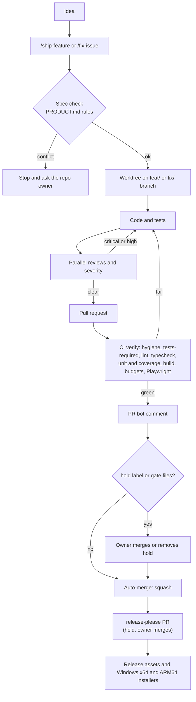

# Pipeline

From an idea to a released installer with little manual work. Day-to-day usage is in [FEATURE_WORKFLOW.md](FEATURE_WORKFLOW.md); the rules it enforces are in [PRODUCT.md](PRODUCT.md) and [CONTRIBUTING.md](../CONTRIBUTING.md); releasing is in [RELEASING.md](RELEASING.md).

The workflow files in `.github/workflows/` are the source of truth for what is live. This page describes how the pieces fit together. The pipeline assumes a private source repo on GitHub with Actions enabled and a solo or small-team owner who can merge.

To turn it on for your app: put the renamed kit (`npm run init-app`, see the [README](../README.md)) in a private GitHub repo, run `node scripts/setupLabels.js` once (needs the `gh` CLI signed in), and follow the one-time setup in [RELEASING.md](RELEASING.md) (`config/release.json` and the `RELEASES_TOKEN` secret). Releases need no other paid service: installers are not code-signed and there is no update server.



## What you do

| Step | You |
| --- | --- |
| Describe the feature | `/ship-feature <plain language>` or `/fix-issue <n>` |
| Look at the result | Read the PR bot comment; `npm run preview:branch -- "#<n>"` for the real thing |
| Ship or stop | Do nothing to ship; add the `hold` label to stop |
| Release | Read the changelog in the release-please PR and merge it |
| Decide | Answer when an agent stops on a product rule, a new cost or a new outbound host |

## Two workflow sets

The nine workflow files described below run only in the private repository, which holds the `pro/` code. The public repository gets a smaller set from the public export, with its own `ci.yml`. A checkout without `pro/` is the public build.

## What runs automatically and when

| What | Workflow | When | Does |
| --- | --- | --- | --- |
| PR CI (`verify` job) | `ci.yml` | Every PR push (a newer push cancels the older run) | Hygiene checks (gitleaks, em dash, keys, personal data), tests-required, lint, typecheck, affected unit tests (`vitest --changed <base sha>`) with changed-file coverage, build, bundle size limit, sidecar budget (studio, cloud marker, runtime), cloud-off build, Playwright |
| Main CI | `ci.yml` | Every push to `main` except docs-only and workspace-only ones, and a manual run with `mode=full` on `main` | Whole suite in 2 shards (`main-unit`), lint and build (`main-build`). No Playwright, never cancelled |
| PR bot | `pr-bot.yml` | After CI and on label or description edits | Updates a sticky comment, squash-merges when green unless `hold` or gate files |
| Weekly flaky run | `flaky.yml` | Sundays, only if `main` changed; also manual | Repeats the test suite 3 times, files or updates a "Flaky tests on main" issue, runs the full Playwright suite |
| Branch cleanup | `branch-cleanup.yml` | Weekly | Deletes merged branches |
| release-please | `release-please.yml` | Daily, and on pushes to `main` | Opens or updates the release PR (labelled `hold`) and starts a full CI run on its branch |
| Release build | `release.yml`, `desktop-windows.yml` | When the release PR is merged | Source zip and checksums (private release only), native Windows x64 and ARM64 installers with a blocking sidecar smoke test and a non-blocking installer smoke test, then the two installers and `SHA256SUMS.txt` go to the public releases repo |
| Desktop check | `desktop-check.yml` | Pushes and PRs that touch `src-tauri/**` | `cargo fmt --check`, `cargo clippy -D warnings`, `cargo test` |
| Dev build | `dev-build.yml` | Manual only | Unsigned "Local App Studio Dev" installer as a pre-release in the source repo |
| Dependabot | `.github/dependabot.yml` | Scheduled | Update PRs |

The `verify` job runs these steps in this order (`ci.yml` is the source of truth; `npm run gate` mirrors them, see "Local gate"): hygiene (trusted config, gitleaks, em dash, keys, personal data), `tests-required` (PR only), `npm ci`, `lint`, `typecheck`, `unit tests`, `coverage (changed files)` (PR only), `build`, `bundle budget`, `sidecar budget`, `cloud-off build`, the web build upload (PR only), `e2e (Playwright)`, `public build`. On `main`, each `main-unit` shard also runs the whole suite again with `APP_PRO_DIR=none` (a public build: the pro twins are not used and the tests that need them skip with a reason).

- `typecheck` runs `node scripts/ci/typecheck.js` (`tsc --noEmit`). Any error outside `src/vendor/` fails the step; vendored errors are counted and printed but never fatal.
- `sidecar budget` builds the studio sidecar bundle (the build resolves to studio because there is no `config/app-spec.json`) and checks it with `check:sidecar -- --mode studio` against `scripts/checks/sidecar-budget.json`, confirms the cloud provider is in that bundle and in `dist/` (`check:cloud-marker -- --require-present`), then builds the bundle again with `APP_MODE=runtime` and checks it with `check:sidecar -- --mode runtime`. The two modes have their own limits (see [BUDGETS.md](BUDGETS.md)).
- `cloud-off build` builds the UI and the sidecar with `APP_CLOUD_AI=off` and requires the provider to be absent (`check:cloud-marker`, see [AI.md](AI.md)).
- `e2e (Playwright)` runs the `flows` and `first-run` projects when the app changed. When something that can change the UI changed it adds `a11y`, and adds `visual` only if a PNG exists under `e2e/__screenshots__/*/`. With no baselines it prints the warning "No visual baselines" and skips `visual` instead of failing every UI change. The npm install in the Playwright container does not download browsers (`PLAYWRIGHT_SKIP_BROWSER_DOWNLOAD=1`); the pinned image already has them.
- The first-run visual-update step: this repo has no Linux baselines yet. After the repo is on GitHub, dispatch `ci.yml` with `mode=visual-update` once on a feature branch (see "Visual baselines"), copy the PNGs into your PR branch and commit them. From then on `visual` runs on UI changes.
- Pool and worker count come from `vitest.config.js` only; `ci.yml` passes no pool flag (see "Vitest projects and pool").

A merge made with `GITHUB_TOKEN` fires no `push` event, so the `merge` job of `pr-bot.yml` starts a full `ci.yml` run on `main` itself after a successful merge. That job is the only one with `actions: write`.

### Which unit tests a PR runs

`scripts/ci/changeKinds.js` decides, `scripts/ci/runUnitTests.js` builds the Vitest command, and both are unit-tested.

- Normal code PR: `vitest run --changed <PR base sha>` (tests whose import graph touches a changed file), plus a list of tests that scan the repo and have no import edge.
- Code means `.js`, `.jsx`, `.ts`, `.tsx`, `.mjs` and `.cjs`. TypeScript counts as code, so a `.ts` or `.tsx` change under `src/` runs the affected tests, not the whole suite.
- Whole suite instead: a removed or renamed `src/` or `server/` code file, a change to `package.json`, the lockfile or the test and build configs, shared test setup or helpers, `src/test-utils/`, `server/db/`, `server/ai/index.js`, `server/netPolicy.js`, `scripts/`, a file under `src/` or `server/` that is not code (css, json, svg), more than 40 changed source files, a Dependabot PR, or a manual run.
- Light changes: a PR that touches only docs (markdown, `docs/`, `LICENSE`) or workspace files (`.env.example`, `.github/ISSUE_TEMPLATE/**`, `.github/CODEOWNERS`, markdown and JSON under `.vscode/` and `.claude/`) sets the `light` output. The heavy steps (`npm ci`, lint, typecheck, unit tests, coverage, build, budgets, cloud-off build, Playwright) skip inside the job, so the required check still completes. The same globs are in the `paths-ignore` of the push trigger, so such a push to `main` starts no run. `.gitignore` is not light, because a test guards its entries.

### Artifacts

Every upload is short-lived (1 day for Playwright reports and flaky artifacts, 3 days for the PR `web-dist` preview build) to keep Actions storage small.

### Visual baselines

New Playwright visual baselines are made in CI, in the same pinned image that checks them, so they match. The `visual-update` mode of `ci.yml` runs in its own job (`visual-baselines`), the only job with `contents: write`. It refuses `main`, `release-please--*` and `dependabot/*` refs, fails unless every staged path is a PNG under `e2e/__screenshots__/`, and pushes one side branch, `ci/visual-baselines-<run id>`.

1. Dispatch: `gh workflow run ci.yml --ref <your branch> -f mode=visual-update` (or `npm run test:visual:update -- --ci`).
2. Fetch the side branch: `git fetch origin ci/visual-baselines-<run id>`.
3. Copy the PNGs into your PR branch: `git checkout origin/ci/visual-baselines-<run id> -- e2e/__screenshots__`, review them, commit and push.
4. Delete the side branch: `git push origin --delete ci/visual-baselines-<run id>`.

## Local gate

`npm run gate` runs the CI `verify` job on your machine (`scripts/ci/gate.js`). Run it before you open a PR; a green gate is what CI will check, minus the PR-only steps.

The steps run in this order, one at a time (never two heavy jobs at once). The left column is the row name in the summary table, the right column is the `ci.yml` step it mirrors.

| Gate step | ci.yml step | What it runs |
| --- | --- | --- |
| hygiene: gitleaks | `hygiene: gitleaks` | `gitleaks git` with `.gitleaks.toml`; skipped with "gitleaks is not on PATH, CI runs it" when the binary is missing |
| hygiene: em dash | `hygiene: em dash` | `scripts/checks/noEmDash.js` |
| hygiene: keys | `hygiene: keys` | `scripts/checks/noPrivateKeys.js` |
| hygiene: personal data | `hygiene: personal data` | `scripts/checks/personalData.js` |
| lint | `lint` | `eslint .` |
| typecheck | `typecheck` | `scripts/ci/typecheck.js` |
| unit tests | `unit tests` | `vitest run` (whole suite) |
| build | `build` | `vite build`, then `scripts/license/writeBuildInfo.js` |
| bundle budget | `bundle budget` | `scripts/checks/bundleBudget.js` |
| sidecar budget (studio) | `sidecar budget` | `buildSidecar.js --minify --bundle-only`, `sidecarBudget.js --mode studio`, `cloudMarker.js --require-present` |
| sidecar budget (runtime) | `sidecar budget` | the same bundle build with `APP_MODE=runtime`, then `sidecarBudget.js --mode runtime` |
| cloud-off build | `cloud-off build` | `vite build` into a folder under the OS temp dir and the sidecar bundle with `APP_CLOUD_AI=off`, then `cloudMarker.js --require-absent` |
| e2e (Playwright) | `e2e (Playwright)` | `playwright test --project=flows --project=first-run --project=a11y` |
| public build | `public build` | `scripts/checks/publicBuild.js` (`npm run check:public`): `vite build` and both sidecar bundles with `APP_PRO_DIR=none`, then `proMarker.js` and `cloudMarker.js --require-absent`. It runs last because it leaves a public build in `dist/` and `.sidecar-build/` |

Steps with no local meaning are left out: `tools`, `git safe directory`, `classify`, `hygiene: trusted config`, `tests-required`, `npm ci`, `coverage (changed files)` and the two uploads. The `visual` project is also left out: its baselines are rendered in the pinned Linux container, so it is Linux and CI only. A unit test (`server/__tests__/ciGate.test.js`) checks that the gate names appear in the `verify` job in the same order and that every other `verify` step is listed as CI only.

Every step starts `node <script>` directly, with no npm wrapper, so the memory figure is the real process tree. When the run ends it prints a table with one row per step: step, status, seconds and peak MB. The status is `passed`, `FAILED`, `skipped` or `not run`. The same table goes to `$GITHUB_STEP_SUMMARY` when that is set.

Exit code: the exit code of the first failing step (1 if it has none). The steps after it are `not run`.

| Option | Effect |
| --- | --- |
| `--quick` | Only the cheap steps, against what your branch changed (below) |
| `--base <sha>` | With `--quick`: diff from the merge base of `HEAD` and that commit (40 hex characters, else exit 2). The pre-push hook passes the remote sha here |
| `--json <file>` | Also write `{ mode, note, exitCode, results }` as JSON (exit 2 without a path) |
| `--dry-run` | Print the plan, with the commands, and run nothing |
| `--repair` | Before the steps, run `eslint --fix` on the changed files and commit it as `chore(gate): mechanical fixes` when the diff is mechanical (below). Never in CI: with `CI` set the gate exits 2 |
| `--protected` | No quarantine: every flaky or failed test fails the step, and `.gate/flaky.json` is never written. Also `GATE_PROTECTED=1` (release) |
| `--no-classify` | Run the test steps without rerunning failures alone and without reading `.gate/flaky.json` |
| `--only <step id>` | Run exactly one gate step by its id, for example `--only "unit tests"`. An unknown id exits 2 and lists the ids |
| `--project <name>` | With `--only "unit tests"`: `frontend`, `pure` or `backend`. With `--only "e2e (Playwright)"`: `flows`, `first-run` or `a11y`. Anything else exits 2 |
| `--shard <i>/<n>` | With `--only "unit tests"` or `--only "e2e (Playwright)"`: pass `--shard=<i>/<n>` to Vitest or Playwright. Needs `1 <= i <= n <= 16`, else exit 2 |
| `--public` | Run the plan as the public build: every step under `APP_PRO_DIR=none`, the studio sidecar proves the cloud provider absent, and `cloud-off build` is skipped. Combines with `--only` |

`GATE_MAX_WORKERS` (a whole number from 1 to 64) is passed to the unit step as `--maxWorkers`. When it is unset the gate adds no flag and `vitest.config.js` decides. Set `GATE_MAX_WORKERS=4` while another heavy job runs on the machine.

`--quick` runs the hygiene steps, lint, typecheck and the affected unit tests, and skips everything from `build` on. The changed files are the diff from the merge base of `HEAD` with `--base`, else `origin/main`, else `main`. Lint gets only the changed `.js`, `.jsx`, `.ts` and `.tsx` files (with `--no-warn-ignored`); above 200 files or 24000 characters of paths it runs `eslint .` instead, to stay under the Windows command line limit. The unit step runs the same plan as CI (`vitest run --changed <merge base>` plus the always-run tests, or the whole suite when `changeKinds` says so) without the coverage flags. A docs-only or workspace-only diff skips lint, typecheck and the unit tests. When no base ref exists, lint runs on the whole tree and the unit tests run the whole suite.

## The gate governs itself

The gate classifies failures, repairs what is mechanical, remembers what it learned and blocks on the rest with a sentence and a next action. It never raises a budget, never weakens an assertion, never skips a failing test by itself and never pushes. Scripts: `scripts/ci/gateClassify.js`, `gateState.js`, `gateRepair.js`, `gateLedger.js`, `gateSummary.js`. `ci.yml` uses the same scripts through `runUnitTests.js` and `runE2e.js`. A run writes its files to `.gate/run/` (emptied at the start); `.gate/` is ignored by git.

### Classifying a failure

| Step | On a non-zero exit |
| --- | --- |
| lint, typecheck, hygiene, build, bundle and sidecar budgets, cloud-off build | **real**. No rerun |
| unit tests | each failed test is rerun once alone: `vitest run <file> --maxWorkers=1 --testNamePattern "^<exact name>$"` |
| e2e | each failed test is rerun once alone: `<file>`, its project, `--workers=1 --retries=0` (while classifying, `GATE_CLASSIFY=1` turns Playwright's own CI retry off) |

A test that passes on the rerun is **flaky**. A test that fails again is **real**, and the summary names it, the first line of the assertion and the first stack frame outside `node_modules`, in plain words first. A failure that cannot be checked is real too: more than 10 unit failures or 5 e2e failures in one step ("Too many tests failed to check each one again, so all of them count as real failures."), a test file that did not load, a missing report. The gate still stops at the first FAILED step.

### Quarantine

State is `.gate/flaky.json`, keyed `kind|file|title` (e2e keys carry the project). In CI it travels as the `gate-state` artifact (retention 30 days, a named exception to the 3 day default).

| Situation | Result |
| --- | --- |
| a test flaky in 2 runs in a row | quarantined for 7 days, in the same run that sees the second flaky result |
| a quarantined test fails or is flaky | it still runs and is reported, but the step does not fail |
| a quarantined test fails 3 runs in a row | released from quarantine, and the step fails |
| the 7 days end | the quarantine and the streaks are dropped, and it is never extended; a new quarantine needs 2 new flaky runs in a row |
| a test passes | its entry is removed (a quarantined entry stays, with streaks reset, until it expires) |
| protected gate | nothing is quarantined, every flaky or failed test fails the step, the file is read for the summary and never written |

A step whose every failure is quarantined shows `passed (quarantined failures)`. The summary always lists quarantined tests with their expiry. The file keeps at most 500 entries (oldest first; quarantined entries are never dropped). `--quick` classifies and updates the file for the tests it ran but never writes the ledger.

### `--repair`

`npm run gate -- --repair` runs `eslint --fix` on the changed code files and nothing else (the repo has no formatter). It commits `chore(gate): mechanical fixes` only when every check passes: no string or template literal changed, and every changed line lies inside a line range that eslint reported as fixable. Otherwise it restores every file and reports "Not repaired: <file> changed more than mechanical fixes, so nothing was changed." A file with uncommitted changes is skipped, and nothing runs when changes are staged ("Skipped repair: there are staged changes."). The pre-push hook passes `--repair`; when the gate made a commit the push stops ("Push again to include it."), because that commit was not part of the push. CI never repairs and never writes to the branch. To undo one, see [DEBUGGING.md](DEBUGGING.md).

### The ledger and the "needs a decision" rule

Every full gate run (not `--quick`, not `--dry-run`), even a failed one, appends one line to `.gate/ledger.jsonl` (ignored by git, trimmed to the last 500 lines; in CI it travels in the same artifact). A line holds the run id, head, branch, exit code, the seconds and peak MB per step, test counts (total, passed, failed, skipped, flaky, quarantined), the quarantine lists and the budgets.

Eight budgets are tracked: `web.initialJsGzipKb`, `web.totalJsGzipKb`, `web.largestJsGzipKb`, `web.totalCssGzipKb` (pins `scripts/checks/bundle-budget.json` and `server/__tests__/ciPipeline.test.js`) and `sidecar.studio.bundleKb`, `sidecar.studio.bundleGzipKb`, `sidecar.runtime.bundleKb`, `sidecar.runtime.bundleGzipKb` (pins `server/__tests__/ciPipeline.test.js` and `server/__tests__/sidecarBudget.test.js`). For each, the summary shows the measured value, the limit, the headroom (`(limit - measured) / limit`, as a percent) and the change since the previous full run. When the headroom is under 2 percent it prints:

```
Needs a decision: raise with a rationale in BUDGETS.md (<id> has <x> percent left; pins: <pin 1>, <pin 2>).
```

That line does not fail the gate. The gate never edits a limit file or a pin: raising a budget is a person's decision, written up in `docs/BUDGETS.md` and made in both pins. `server/__tests__/gateNoSelfRaise.test.js` checks that no gate script writes outside `.gate/`, and that the `verify` job has no `git commit` or `git push`.

### Workflow checks

`npm run check:workflows` (`scripts/ci/workflowCheck.js`, also part of `npm run check`) validates the nine workflow files without a YAML library. It prints `workflowCheck: 9 workflows, 0 problems`, or one line per problem such as `ci.yml:63 job verify: needs "lint" which does not exist`, and exits 1.

| Rule | Checks |
| --- | --- |
| WF-1 | top-level `name`, `on`, `permissions`, `jobs` exist; no tabs; no em or en dash; `${{` and `}}` balance on every line |
| WF-2 | job ids are lowercase letters, digits and hyphens, and unique; each job has `runs-on` or `uses`; job names are unique in the file; in `ci.yml` the job `verify` keeps its id and name (the PR bot and branch protection read it) |
| WF-3 | `needs` targets exist in the same file, no job needs itself, no cycle |
| WF-4 | every `uses:` is a local workflow or action that exists, a `docker://` image pinned by `@sha256:`, or `<owner>/<repo>@<40 hex>` followed by a `# v<version>` comment |
| WF-5 | every `run:` that calls `node <file>`, `bash <file>.sh` or `./<file>` names a file that exists; every `npm run <name>` names a `package.json` script; `npx <bin>` is one of `vitest`, `playwright`, `vite`, `tauri`, `eslint`, `tsc` |
| WF-6 | no `secrets.` inside a job or step `if:` |
| WF-7 | each step has `run` or `uses`; step ids are unique per job; every `steps.<id>.` reference names a step in that job |
| WF-8 | the dry run rules below |
| WF-9 | a workflow called with `uses: ./.github/workflows/x.yml` declares `on: workflow_call` |

**Dry runs.** Seven workflows have a `graph_check` boolean input on `workflow_dispatch` and a `graph-check` job (`if: inputs.graph_check`) that runs `node scripts/ci/workflowCheck.js --graph .github/workflows/<file>`, which prints the jobs in run order with their `needs`. Every other job in that file has `!inputs.graph_check` in its `if`, so a dry run runs nothing else. The seven are `ci.yml`, `flaky.yml`, `release.yml`, `release-please.yml`, `dev-build.yml`, `branch-cleanup.yml` and `desktop-check.yml` (which gained a `workflow_dispatch` trigger for this). `desktop-windows.yml` has no dry run: it is `workflow_call` only, and it is checked through the `release.yml` graph, which includes the called file, and by WF-9. `pr-bot.yml` has none either: it runs on `pull_request_target` and `workflow_run` with write tokens, and a manual trigger would widen what can run there, so it is checked statically only. The `release.yml` dry run still needs the required `tag` input, so a manual check needs a dummy tag (any value). Without a GitHub remote these jobs never run; the local proof is WF-8 plus `--graph`, run for each file by `server/__tests__/workflowCheck.test.js`.

**`flaky.yml` quarantine issues.** The `quarantine-issues` job restores the newest `gate-state` artifact from any branch and runs `node scripts/ci/flakyReport.js quarantine-issues`, which opens one issue per test quarantined in the last 8 days (title `Quarantined test: <file> :: <title>`, label `quarantine`), unless an open issue with that title exists. Without `GH_TOKEN` or a repository (no remote, or any local run) it opens nothing, prints "No GitHub remote or token, so no issue was opened. Newly quarantined: <n>." and exits 0. `scripts/setupLabels.js` does not create the `quarantine` label yet (tracked).

**actionlint.** A vendored actionlint is still not available here (phase 11 could not fetch a pinned, checksummed binary), and it is not fetched. The validator above and the pins in `server/__tests__/ciPipeline.test.js` are the check.

## Phase scripts

A phase needs the gate twice, once for the pro build and once for the public build, in pieces small enough for a 600 second tool cap. These are the pieces. This section covers the gate flags, the quarantine list, the resumable phase gate (`scripts/phase/gate.js`) and the worktree cleanup (`scripts/phase/cleanup.js`).

**One step, one build.** `--only`, `--project`, `--shard` and `--public` (table above) run a single gate step. The unit step with `--project frontend` runs `vitest run --project frontend`; the e2e step with `--project flows` replaces the three `--project=` arguments with one.

```powershell
npm run gate -- --only "unit tests" --project frontend --public
```

Refusals, all exit 2 with the reason on stderr and nothing run:

| Flag use | Message starts with |
| --- | --- |
| `--project` or `--shard` without `--only`, a project outside the step's list, a bad shard | `--project needs --only ...` or `--shard needs --only ...` |
| `--only` with an unknown id | `--only needs a step id: one of ...` |
| `--quick` with `--only`, `--project`, `--shard` or `--public` | `--quick cannot be combined with --only or --public` |
| `--repair` with `--only` | `--repair cannot be combined with --only` |

`--dry-run`, `--json`, `--protected` and `--no-classify` combine with all of them. With `--json` the file keeps `{ mode, note, exitCode, results }` and adds `v: 2`, `build`, `only`, `project`, `shard`, `head`, `runId`, `at`, `tests`, `failures`, `budgets`, `decisions` and `ledgerLine`.

**The ledger by build.** A local ledger line now carries `build` (`pro` or `public`), `only`, `project` and `shard`; `mode` is `full` or `only`. A line without `build` reads as pro. The headroom and "change since the previous run" of a budget compare only lines of the same build, and one `--only` line does not hide the budgets of an earlier `--only` line. The decision line names the build:

```
Needs a decision (pro build): raise with a rationale in BUDGETS.md (<id> has <x> percent left; pins: <pin 1>, <pin 2>).
```

The gate never raises a limit: a raise is a person's commit with a rationale in `docs/BUDGETS.md` and both pins; the ledger only prints "Needs a decision".

**The quarantine list.**

```powershell
node scripts/ci/flakyReport.js list
```

It reads `.gate/flaky.json` (`--file <path>` for another, `--json` for raw entries) and prints the active quarantines with their dates, then the tests that were flaky once and are not quarantined yet. It writes nothing and exits 0 (2 for an unknown flag).

### The phase gate

`scripts/phase/gate.js` (`npm run phase:gate`) runs the hand gate list of a phase as resumable steps. Each step is one child process in the foreground (a gate step runs `scripts/ci/gate.js --only ...`), and every `--next` call runs one step, or a heavy step with one light step beside it (see "Light steps" below), so one call stays under a 600 second tool cap. The phase number comes from `--phase <N>`, else from the folder name (`las-wt-phase24`), else from the branch (`feat/phase24-...`); with none of these it exits 2.

```powershell
npm run phase:gate -- --both-builds --next
```

Give exactly one command:

| Command | Effect |
| --- | --- |
| `--next` | Run the next pending step and stop. The first call creates the run |
| `--all` | Run every pending step in order, in one call. A step that did not pass does not stop it; steps that need it become not run. `--wait-max` defaults to 1800 s here (60 s for `--next`) |
| `--status` | Print one line per step (key, status, seconds, reason) and `next: <key>` |
| `--dry-run` | Print the plan with each child command; writes nothing |
| `--reset` | Rename the state to `phase-<NN>.<runId>.json` (a damaged file too) so the next call starts a new run |
| `--rerun <key>` | Put one step, and the steps it needs, back to pending. Keys look like `pro:unit-frontend` |

| Flag | Effect |
| --- | --- |
| `--phase <N>` | The phase number (1 to 999) |
| `--both-builds` | Plan the pro build, then the public build. The default is the pro build only |
| `--build pro\|public` | Plan one build only |
| `--no-classify-flakes` | Pass `--no-classify` to every gate step |
| `--wait-for <worktree name>\|any` | Before a heavy step, wait while a node, cargo or rustc process of that worktree (or, with `any`, of the main checkout or another worktree) runs vitest, playwright, vite, buildSidecar or cargo. It polls every 20 s. The default is `any`. After an interrupted step, a heavy process that names this worktree (an orphan of the killed step, or a dev server you started) blocks too, and the call lists its pid as a leftover of this worktree. When the process list cannot be read the call prints `phase-gate: cannot read the process list; run --next again` and exits 75 |
| `--wait-max <s>` | How long to wait (0 to 86400). When it runs out the call prints `phase-gate: waiting on pid <pids>; run --next again` and exits 75 |
| `--max-workers <n>` | 1 to 32, default 4. Sets `GATE_MAX_WORKERS` and `VITEST_MAX_WORKERS` for the children |
| `--e2e-shards <n>` | 1 to 8, default 3: how many shards the `flows` e2e project is split into |
| `--unit-shards <n>` | 1 to 8, default 1: with more than 1, each `unit-<project>` step becomes `unit-<project>-<i>of<n>` (Vitest `--shard`); the table row sums the shards |
| `--log-dir <dir>` | Where the step logs go |
| `--json <file>` | Write `{ v, state, rows, decisions, headroom }` after the call |
| `--md <file>` | Write the gate table as markdown after the call: a Gate row per check, a Pro and a Public column, the budget headroom and a "Not passed" list. The run id, head and builds are in its first line |
| `--no-overlap` | Run one step per call: no light step beside a heavy one. Not a plan option; it can differ from call to call |
| `--allow-moved-head` | Go on although `HEAD` is not where the run began |

#### Light steps

Every step in the plan has a `light` flag (`--dry-run` prints it). The light steps are the five hygiene steps (gitleaks, em dash, keys, personal data and `check-extra`), `lint`, `typecheck` and `unit-pure`, in both builds (so the public lint is light too). Everything else that is heavy (the other unit projects, `template-parity`, `build`, the sidecar budgets, `cloud-off`, the e2e projects and `public-build`) is not. `unit-pure` is light and still waits for a quiet machine before it starts, as any vitest run does.

The scheduler rule (`nextPair` in `scripts/phase/lib/gateRun.js`): one call runs the next pending step, and when that step is heavy it also starts the first pending light step beside it; when the next step is light it also starts the heavy step that would come next without the light ones, if that step can start. Never two heavy steps and never two light steps at once; a step that is neither (the budget and marker checks) runs alone. The call ends when both children ended; both results are written, and the last line is the first step of the call that did not pass, else the main step. If the heavy partner has to wait for another worktree, the light step runs alone and the next call waits for the heavy one. A light gate child gets `GATE_RUN_DIR=.gate/run-light` so its start (every gate child clears its run folder) does not wipe the folder of the heavy step beside it; In a pair the light step also gets `GATE_LIGHT_CHILD=1`, which makes `gateState.js` and `gateLedger.js` skip their writes, so the other step records `.gate/flaky.json` and the ledger (a light step that runs alone records them as usual); the state file is written through a temp file named for the process, with one retry on EPERM. `unit-pure` beside a heavy step runs on half the workers (`max(1, floor(max-workers / 2))`), so a pair never runs 2 x `--max-workers`. `--no-overlap` turns the partner off. Measured gain: see the phase 27 STATUS table. The gate takes the shared `wait.js` heavy-step lock (`las-heavy.lock`) for a heavy step only, after the quiet check and just before it starts, and releases it when the step ends (also when it fails); a live other holder gives exit 75 for a heavy step, a light partner never takes the lock (the heavy primary holds it), `unit-pure` running alone takes it like a heavy step, and the gate holds nothing between calls. Do not wrap the gate itself in `wait.js -- <command>`: that parent would hold the lock and the gate would wait on it.

`--build`, `--both-builds`, `--no-classify-flakes`, `--max-workers`, `--e2e-shards`, `--unit-shards` and `--log-dir` are fixed when the run is created. A later call that gives a different value exits 2 with "the plan options of this run are fixed"; run `--reset` to start again. A later call also exits 2 when `HEAD` moved ("head moved from ... to ..."), unless `--allow-moved-head` is given.

**The plan.** The pro build runs first, then the public build. A step key is `<build>:<slug>`.

| Build | Steps, in order |
| --- | --- |
| both | `hygiene-gitleaks`, `hygiene-em-dash`, `hygiene-keys`, `hygiene-personal`, `check-extra` (`workflowCheck.js`, then `proMarker.js --require-present --source`), `lint`, `typecheck`, `unit-frontend`, `unit-pure`, `unit-backend` |
| pro only | `template-parity` (the backend `templateParity` test) |
| both | `build`, `bundle-budget`, `sidecar-studio` |
| pro only | `pro-marker-studio` |
| both | `sidecar-runtime` |
| pro only | `pro-marker-runtime`, `cloud-off` |
| both | the `flows` e2e project: `e2e-flows-1of3`, `e2e-flows-2of3`, `e2e-flows-3of3` (`e2e-flows` when `--e2e-shards 1`), then `e2e-first-run` and `e2e-a11y` |
| public only | `public-build` (`check:public`) |

The public build runs every gate step with `--public` and every direct step with `APP_PRO_DIR=none`. Unit, build, sidecar, cloud-off, e2e and template-parity steps are heavy (the ones `--wait-for` waits before). `bundle-budget`, both sidecar steps and every e2e step need `build`; each pro marker step needs its sidecar step. The state records which build last wrote `dist/` and `.sidecar-build/`; when a step needs a build the folder does not hold (after a `--rerun`), its producer runs again first. A pending step whose needed step did not pass is recorded as not run ("needs <key>, which did not pass") and no child runs for it.

**State and logs.** The state is `.gate/phase/phase-<NN>.json`, written atomically before and after every step. It is not under `.gate/run/` because `scripts/ci/gate.js` empties that folder at the start of every run, and each step is a gate run. Logs default to `.gate/phase/p<NN>/logs/p<NN>-<build>-<slug>.log` (for example `p24-pro-unit-frontend.log`); the gate result of a step is `.gate/phase/p<NN>/<build>-<slug>.json`. A step that did not pass prints the last 30 lines of its log. `.gate/` is ignored by git.

**Exit codes.**

| Code | Meaning |
| --- | --- |
| 0 | A step ran, whatever its result, or nothing is left to run (also `--status`, `--dry-run`, `--reset`, `--rerun`) |
| 2 | Usage error, no phase number, a damaged state file, `--rerun` of an unknown key, the plan options changed, or `HEAD` moved |
| 3 | Another call of the phase gate is running, or the child of an earlier call still runs (`the step <key> is still running in pid <n>`); nothing was changed. The driver and its child are both recorded with their creation time, so a reused pid does not block the run. A step is reported interrupted only when both are gone |
| 75 | `--wait-for` ran out of time before a heavy step, or the process list could not be read |

The exit code says nothing about the result of the step. Read the last line or `--status`.

**The resumable loop.** An agent under a 600 s tool cap calls `npm run phase:gate -- --next` again and again. The last line of each call is `phase-gate: <key> <status> <seconds>s; <n> left`, and the last line of the call that finds nothing left is `phase-gate: complete`. Stop on that line. On exit 75 another worktree is running a heavy job: call `--next` again. Every heavy step waits for the other worktrees by default (`--wait-for any`). A step that took over 540 s prints a warning: raise `--e2e-shards`, or run `--all` at a terminal.

**An interrupted step.** If a call is killed (a timeout, the memory reaper), the next call finds the recorded pid dead and reports the step as not run: "interrupted (killed, timed out or memory reaper); not restarted, --rerun <key> to run it again". It never restarts the step by itself. Run `--rerun <key>`, then `--next`.

When the run is complete and the public build passed, the last call also prints that `dist/` holds a public build; run `npm run build` before a pro e2e.

### Phase cleanup

`scripts/phase/cleanup.js` (`npm run phase:cleanup`) ends the processes a finished phase left behind, removes its worktree, its sandbox and temp folders, and frees its port block. It is Windows only: elsewhere it prints a note and does nothing. The default is a dry run that prints the plan and changes nothing; `--force` does it.

```powershell
npm run phase:cleanup -- --phase 24
npm run phase:cleanup -- --phase 24 --force
```

| Flag | Effect |
| --- | --- |
| `--phase <N>` | Required. The worktree is the listed one named `las-wt-phase<N>` |
| `--worktree <path>` | The worktree to remove, instead of the name above. It must be a listed worktree; the main checkout is never a target |
| `--dry-run` | The default; it cannot be combined with `--force` |
| `--force` | Stop the listed processes and remove the folders |
| `--keep-worktree` | Do everything except removing the worktree |
| `--ports <from>-<to>` | The phase's port block (1024 to 65535, at most 1000 ports). Else it comes from `phases.json` |
| `--sandbox <name>` | An extra sandbox folder name under the temp `local-app-studio-sandbox` folder (repeatable). Folders named `p<N>`, `p<NN>` or `phase<N>`, alone or followed by `-`, `_` or `.`, are found by themselves |
| `--since <ISO>` | Only temp folders created after this time count as leftovers. Default: when the worktree folder was created |
| `--owner-pid <pid>` | One more process that is never stopped (repeatable) |
| `--workspace <dir>` | The folder with `phases.json`. Default: `local-app-studio-workspace` in the home folder |

**What it lists.** A process belongs to the phase when its current directory is in the worktree, its command line names the worktree or a phase sandbox folder, or it is a node process holding a port of the phase's block. The dry run prints them as a table (pid, name, cwd, command, why, action), then one line per folder step.

**Refusal rules.** A listed process is refused (row action `refused: <why>`) by the first rule that applies, in this order:

1. It is this process or one of its children.
2. It is an ancestor of this process.
3. It is an owner pid (four are built in, plus each `--owner-pid`).
4. It holds an owner port (4321, 4791, 5174 or 11434).
5. Its command line or current directory names the main checkout.
6. It names another worktree.
7. It is not a dev tool. Dev tools are node, bash, sh, cmd, powershell, pwsh, git, esbuild, cargo and rustc, and chrome, chromium or headless_shell started from `ms-playwright`.
8. A child of it is protected by rules 1 to 6.

Other refusals: `--force` stops with exit 1 when the port listing cannot be read, so the owner ports are unknown; the worktree is kept when this process runs inside it, when a process still holds it as its current directory after the stop, or when `git worktree remove` (never run with `--force`) refuses because of uncommitted or locked work.

**The order of a run.** Scan, print, then with `--force`: 1. stop each allowed process by pid with its whole tree (after a re-read proves the pid is still the same process; a reused pid is skipped); 2. wait 2 s and scan again; 3. `git worktree remove` and `git worktree prune`; 4. delete a leftover worktree folder, only if it is not or inside the main checkout or another worktree; 5. delete the sandbox folders and the `tmp.*` folders in the temp folder that were created after `--since`, idle for 30 minutes and used by no process; 6. mark the phase's block `free` in `phases.json`. When `phases.json` is absent it prints "phases.json not found, skipped" and goes on.

Exit codes: 0 for a dry run or a finished cleanup, 1 when a step could not finish (the last line is `not finished: <steps>`), 2 for a usage error or no listed worktree for the phase. The last line of a finished run is `cleanup done`.

### Every phase script

All of `scripts/phase/`, in the order a phase uses them. Each takes the phase from `--phase`, else from the folder name or the branch, and reads the gate JSON, STATUS and the repo instead of typed numbers. Every script has a dry run, and a unit test in `server/__tests__/` (`eval.js`: `pro/server/__tests__/phaseEval.test.js`). The two shared files are the port registry `phases.json` (workspace folder) and the heavy-step lock `las-heavy.lock` (temp folder).

| Script | Purpose | Flags | Dry run |
| --- | --- | --- | --- |
| `new.js` | Start a phase: worktree `../las-wt-phase<N>` on `feat/phase<N>-<slug>`, `npm ci`, a port block, and the facts section of the brief (base, ports, wait rule, last gate steps, budgets, test counts, `flakyReport.js list`, carried owner questions) | `--slug` (required), `--phase` (default: newest docs folder plus one), `--base`, `--no-install`, `--facts-out`, `--workspace` | `--dry-run` prints the facts section and creates nothing |
| `ports.js` | The port registry: owner ports (4321, 4791, 5174, 11434, never allocated), the pool, one block per phase; `cleanup.js` frees the same file | `--list` (default), `--live`, `--allocate`, `--free`, `--check <port>`, `--phase`, `--size`, `--file`, `--workspace` | `--dry-run` prints the allocation or the freeing and writes nothing |
| `wait.js` | The one wait command and heavy-step lock for the gate, critics and orchestrators: waits while the lock has a live holder pid (a dead holder is a stale lock and is taken over; the lock is read back after it is written, and an unreadable file younger than 2 s counts as held) or another worktree runs vitest, playwright, vite, buildSidecar or cargo; with `-- <command>` it holds the lock while the command runs. Exit 75 = busy past `--max-wait`, call again | `--owner`, `--max-wait` (240), `--poll` (20), `--wait-for`, `--lock`, `--cwd`, `-- <command>` | `--dry-run` prints the holder, the foreign pids and what it would do; takes no lock |
| `gate.js` | The resumable two-build phase gate (above) | see "The phase gate" | `--dry-run` |
| `state.js` | The resume block for a cut-off orchestrator: head and branch, uncommitted files, STATUS rows ticked and open, the last gate step, the phase's ports, node, cargo and rustc processes in this worktree. Read only | `--phase`, `--gate`, `--workspace` | `--dry-run` accepted; it never writes |
| `merge.js` | Compose `merge-p<NN>.txt` from the STATUS ticked rows and the gate JSON rows in the shape of the earlier merge messages, write it, print it. Merges (`git merge --no-ff -F`, no shell) only with `--yes`, and only when this worktree is clean, the gate ran at HEAD, the gate has at least one step and every step is pass or fail-flake (pending, running, not-run and fail-real refuse) and the main checkout is clean on the base | `--phase`, `--gate`, `--out`, `--subject`, `--narrative`, `--base`, `--trailer`, `--allow-moved`, `--yes` | `--dry-run` prints the message, writes nothing |
| `record.js` | Append the "Gates at" block (the gate `--md`, unedited) and a decision entry draft to a file you give; write the memory paragraph draft to `--memory-out`. Append only, not twice for one run, refuses a file named `OVERVIEW.md` or any path under `~/.claude` (also for `--memory-out`) | `--append-to`, `--memory-out`, `--md`, `--gate`, `--phase` | `--dry-run` prints the blocks, writes nothing |
| `preview.js` | The owner's preview on 4321: refuses unless every holder of the port (IPv4 and IPv6) is node running a `server.js` that resolves inside the main checkout, stops each by pid, `npm run build` and `check:bundle` (clean main checkout, as `devRefresh.js`), starts it detached with the proof data folder and waits for the port. Run it only when the owner asks | `--status` (default), `--stop`, `--restart`, `--port`, `--data`, `--dir`, `--no-build`, `--create-data` | `--dry-run` prints the plan and the checks, changes nothing |
| `cleanup.js` | End a finished phase (above). Its own process, the shell above it and what it started never count as holders of the worktree | see "Phase cleanup" | the default |
| `pro/scripts/phase/eval.js` (pro only) | The real-model eval loop: one case per child process through `wait.js`, results merged per model into one JSON like `pro/evals/2026-11-07-qwen2.5-3b-regression.json`; the output file is the state, a case already in it is skipped, exit 75 = call again | `--models` (required), `--suite`, `--cases` or `--cases-from`, `--include-not-run`, `--out`, `--budget` (480), `--case-wait`, `--note` | `--dry-run` prints the children and a shape check, loads no model |

## Hooks

- `pre-commit` is unchanged: it lints staged files, then runs the em dash, personal-data and private-key checks.
- `pre-push` (`.githooks/pre-push`, which runs `scripts/ci/prePush.js`) runs `npm run gate -- --quick --repair`, so mechanical lint fixes are committed for you and the push stops once to include them. Git gives the hook the remote sha of each pushed ref; when there is exactly one, it is passed as `--base`, so commits you have not pushed yet are checked even when you push from `main`. A new branch, a deleted ref or several refs at different shas pass no `--base`. Likewise the one pushed local sha is passed as `--head` when it is not the checked-out commit (`git push origin other-branch`), so the gate diffs what is pushed and not `HEAD`; several different local shas pass no `--head` and the gate diffs `HEAD`. `--base` and `--head` each need a 40 hex sha, and giving either without a value exits 2. If the gate fails the push does not happen.
- Skip it once with `GATE_SKIP=1 git push` (PowerShell: `$env:GATE_SKIP = '1'; git push; Remove-Item Env:GATE_SKIP`). Only the exact value `1` skips; `0` or an empty value runs the gate.
- `npm install` installs the hooks: the `prepare` script runs `scripts/installHooks.js`, which sets `core.hooksPath` to `.githooks` for this repo only.

## Vitest projects and pool

`vitest.config.js` defines three projects. A test file lands in exactly one:

| Project | Environment | Files |
| --- | --- | --- |
| `frontend` | jsdom | `src/**/__tests__/**/*.test.{jsx,tsx}`, plus the `.js` and `.ts` tests listed in `SRC_DOM_TESTS` (13 files that use `document`, `window` or `localStorage`) |
| `pure` | node | the other `src/**/__tests__/**/*.test.{js,ts}`: tests of src code that need no DOM |
| `backend` | node | `server/__tests__/**/*.test.js` |

A new `.js` or `.ts` test under `src/` that needs a DOM either goes into `SRC_DOM_TESTS` or is written as `.jsx` or `.tsx`. With the three projects the suite is 511 files (frontend 145, pure 91, backend 273) and 9525 tests. jsdom is created once per frontend file, so moving DOM-free tests to `pure` cut jsdom creations from 233 to 145 and its setup time from 251.6 s to 185.7 s.

Pool and worker count were measured on one machine (10 cores, 15 GB, Windows 11, Node 24) with 4 workers and the full suite of 511 files:

| Config | Wall | Peak MB | Result |
| --- | ---: | ---: | --- |
| forks, every project isolated (chosen) | 214.8 s | 2307 | green except one failure since fixed (`packageTemplate` imported a Studio helper) |
| threads | 228.2 s | 2096 | same |
| forks, `pure` with `isolate: false` | 217.6 s | 2272 | no gain |
| forks, frontend on `vmThreads` | 167.0 s | 4108 | 42 new failures (`ReadableStream` not defined, `Cannot redefine property: location`); rejected |
| final committed config, no CLI flags | 221.6 s | 2300 | same one failure, since fixed |

Chosen settings: the default `forks` pool, every project isolated, and `maxWorkers` = `VITEST_MAX_WORKERS` if set, else the smaller of 4 and the core count minus one (never below 1), so a 4 vCPU runner uses 3. The tests have 20 s (frontend, pure) or 45 s (backend) time limits for loaded machines.

Measured again in phase 27 on a quiet machine (the heavy-step lock held, so no other heavy step ran; 10 cores, 16 GB, Windows 11, Node 24, `frontend` project only, `scripts/ci/measureRun.js`; the tree was still being edited by other agents, so a run can differ in the files it holds): 4 workers 303.2 s and 2416 MB peak; 6 workers 240.7 s and 3366 MB peak (226 files, 2928 tests both times). Six is 20.6 percent faster and stays under 4 GB, but the 6-worker run had one failure (`designNewTable.dialog.test.tsx` "Cancel puts the focus back on the button that opened it": the New table dialog was not found in the 5 s patience, a load flake), and no 4-worker run of the same tree failed (one more full run at 4 workers beside two e2e specs was green too). So the default stays 4; `VITEST_MAX_WORKERS=6` (or the gate's `--max-workers 6`) is the measured option for a quiet machine with nothing else running. 8 workers were not measured. The same phase split the four slowest frontend files by describe block (DesignTab 160.7 s, newParts 83.0 s, FeatureBuilderPage 74.2 s, designNewTable 53.9 s, 214 tests) into 14 files with no test lost: the frontend step went from 336.8 s to 303.2 s at 4 workers (peak 2396 to 2416 MB), and none of the 14 files is above 46 s. The a11y e2e step was cut the same way: `studioAxe.spec.js` (23 screens in two themes, 46 tests in a pro build) became five route-group files (`studioAxeApps`, `Features`, `Prompt`, `Design`, `Steps`), each with its own sandbox server, so they run on separate Playwright workers: the a11y project (71 tests both times) went from 149.7 s to 64.4 s (peak 5934 to 6168 MB). A Studio screen added to `e2e/a11y/studioShared.js` needs a `group`, or the run fails.

The suite did not reach the 100 s target: it is about 840 worker-seconds of work, so 4 workers cannot go under about 210 s, and what is left is real jsdom render work (the Design tab family costs about 0.7 s per test mount).

## Measuring a run

`scripts/ci/measureRun.js` runs one command and reports its wall time and the peak memory of the whole process tree (the command and every child). It has no dependency; on Windows it samples with a long-lived PowerShell, elsewhere with `ps`.

```powershell
node scripts/ci/measureRun.js [--json <file>] [--interval <ms>] -- <command> [args...]
node scripts/ci/measureRun.js --json run.json -- node node_modules/vitest/vitest.mjs run --maxWorkers=4
```

It prints `[measure] {"command":...,"exitCode":...,"wallSeconds":...,"peakMB":...}`, writes the same object to `--json`, and exits with the command's exit code. The sampling interval is 2000 ms by default (250 ms at least). The command is run through the shell, so quote its arguments yourself. `npm run gate` uses the same sampler for the peak MB column.

### The preview-start line

A Playwright run prints one line at its end when a test started a Preview child: `[preview-start] count=<n> timeouts=<t> p95=<s>s max=<s>s (the harness waits 30 s)` (`e2e/support/previewStartReporter.js`; `e2e/pages/preview.js` records the seconds from the click that starts the child to "Your app is running." as a `preview-start` annotation, a start that hit the 30 s wait as a `preview-start-timeout` one (`timeouts=<t>`), both read per attempt so a retry is not counted twice, and `runE2e.js` and the gate pass the reporter). Judge a load timeout against it: on a quiet machine a child starts in 1 to 12 s, so a p95 near 30 s says the machine was overloaded (a scheduling defect, run it alone or wait for the other phase), and a small p95 beside a timeout says the cause is something else. Only the helpers that go through `preview.js` are counted; a spec that waits for the sentence by itself is not.

## What stays manual

- `npm run eval:ai` (needs a real local Ollama; see `pro/docs/EVALS.md` (pro, not in the public source)).
- Code signing: installers are unsigned (the kit costs $0 to run in this respect), so Windows SmartScreen warns on first run. Add a signing step only if you decide to buy a certificate (see [RELEASING.md](RELEASING.md#code-signing)).
- Visual baseline updates.
- Merging PRs that touch gate files (`.github/**`, `scripts/ci/**`, `scripts/checks/**`, `scripts/release/**`, `scripts/desktop/**`, `scripts/license/**`, `src-tauri/tauri*.json`, `src-tauri/capabilities/**`, `src-tauri/src/**`, `Cargo.toml`, `build.rs`, `config/**`, shared test setup and helpers, test and release config), every PR that changes more than 200 source files, every PR that uses the `no-tests-needed` waiver, and every release PR.
- macOS and Linux desktop builds exist as manual options in `release.yml`, but only Windows is tested.

## Actions minutes

The repo is private, so billed minutes are multiplied by runner OS: Linux 1x, Windows 2x, macOS 10x. The everyday gate runs on Linux. Windows runs happen only in the release and in `dev-build.yml`. A full release (source job, both Windows installers, publish) is roughly 80 to 100 billed minutes. Build one platform while you iterate on the desktop pipeline.

### CI minutes

This is an estimate for the part that phase 11 changed, the unit test step. It is not a measurement of Actions runs; replace it with the billable time from `gh api repos/<owner>/<repo>/actions/runs/<id>/timing` after the first real runs.

Method: billed minutes per month = triggers per month x job wall minutes, rounded up per job, x the OS factor (Linux 1).

Assumptions, all stated here and none measured:

- Triggers per month: 40 PR pushes and 20 pushes to `main` (the owner's rough guess).
- CI step time = the local time x 2.5, because the measuring machine has 10 cores and a runner has 4 vCPU.
- Local unit suite time: before phase 11, 317.8 s, 344.2 s and 319.8 s (mean 327.3 s; two projects, 491 files); after, 221.6 s (three projects, 511 files).
- Each `main-unit` shard has about 1.5 minutes of setup (checkout, setup-node, `npm ci`) and gets an even share of the suite.
- Before: every PR with an app change ran the whole suite (TypeScript counted as non-code), and `main-unit` had 3 shards. After: `main-unit` has 2 shards, and a PR can run only the affected tests.
- Left out because they did not change or were not timed: lint, typecheck, build, budgets, cloud-off build, Playwright, the PR job setup, the weekly flaky run, release-please, branch cleanup, Dependabot and releases.

| | Before | After |
| --- | ---: | ---: |
| Unit suite on a runner (local time x 2.5) | 13.6 min | 9.2 min |
| `main-unit` per push: shards x rounded-up wall | 3 x 7 = 21 min | 2 x 7 = 14 min |
| 20 main pushes | 420 min | 280 min |
| 40 PR pushes, unit step, every PR runs the whole suite | 545 min | 369 min |
| Total, unit step plus `main-unit` | 965 min | 649 min |

The "after" PR line is an upper bound: it assumes every PR still runs the whole suite. A PR that changes only TypeScript or a few server files runs `vitest --changed` and costs less; the share of such PRs and the cost of a changed run were not measured here (the method is to run `planUnitTests` over the last 30 `main` commits and count the test files `vitest list --changed <sha>` returns). Docs-only and workspace-only PRs skip the unit step, and such pushes to `main` start no run. So the real figure is between 649 min and 280 min (the `main-unit` part alone) for these steps. The 2 shards save about 7 minutes per push because each shard pays its own setup; sharding saves wall time, not minutes.

## The tests waiver

A change to `src/` or `server/` needs a test change, or both the label `no-tests-needed` and a `No tests needed because: <reason>` line in the PR body. The `coverage (changed files)` step fails below a 60 percent floor and never reads the waiver. The PR bot decides live: it accepts that one failure only when the label is on the PR, the reason line is present and the repo owner applied the label, and then it never auto-merges. A label applied by anyone else, including a workflow token, is ignored. The check trusts the GitHub account, so an agent running `gh` with the owner's login would look like the owner: the `/ship-feature` command forbids adding the label and asks the owner instead.

## Accepted risks

- `PERSONAL_DENYLIST` (an optional secret with private terms) is available to the personal-data hygiene step, which runs on PR head code. A malicious same-repo PR could print it. Accepted for a private repo with trusted authors; gate files always need the owner's own merge.
- In `visual-baselines`, steps in the same container could tamper with files before the push step. Mitigated by the PNG-only path check and by refusing `main`, release and Dependabot refs.
- PR test code runs in the `verify` job before the coverage script. This is inherent to running a PR's tests; only trusted authors should open PRs against a private repo.
